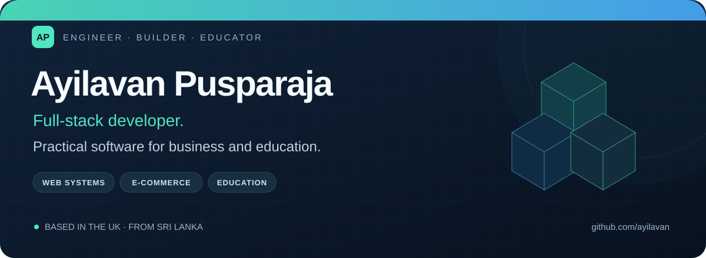

  

<h1 align="center">Hi, I'm Ayilavan 👋</h1>

  <strong>Software Engineering Graduate · Full-Stack Developer · Founder, 99NEX Technologies</strong>

  <a href="https://99nex.info">99NEX Technologies</a> &nbsp;•&nbsp;
  <a href="https://github.com/ayilavan?tab=repositories">Explore my repositories</a> &nbsp;•&nbsp;
  <a href="mailto:info@99nex.info">Let's connect</a>

---

## Software that makes everyday work easier.

I'm a developer from Sri Lanka, based in **Northampton, United Kingdom**. I build web applications for businesses and education, combining software engineering with hands-on experience in retail, e-commerce, and teaching.

At **99NEX Technologies**, I turn client requirements into working products—from planning and development to deployment and ongoing improvements. I care about clear interfaces, reliable workflows, and making systems useful on a phone as well as a desktop.

- 🎓 **BSc (Hons) in Software Engineering** — University of Kelaniya, Sri Lanka.
- 🛠️ **My focus:** full-stack applications, business systems, and e-commerce.
- 🤝 **How I work:** understand the problem, build carefully, test the experience, and keep improving.
- 📚 **Beyond development:** online mathematics teaching and supporting small businesses.

## Selected work

### 01 / 99NEX Order Desk

A mobile-first wholesale ordering platform connecting customers, warehouse teams, managers, and drivers. The project covers product ordering, picking and packing, delivery tracking, invoices, and operational reporting.

**React · TypeScript · Supabase · PostgreSQL · Netlify**  
[Visit Order Desk ↗](https://wholesale-order-desk.99nex.info)

### 02 / AK WholesalePro

A B2B platform for managing products, shops, orders, buying lists, invoices, and outstanding balances. Built around the everyday needs of a wholesale business, with role-based access and ongoing production support.

**React · Node.js · Express · MongoDB Atlas · Vercel**

### 03 / 99NEX EduManage

An education management platform under development, bringing together classes, QR attendance, fees, lessons, exams, and role-based portals for education centres.

**React · TypeScript · Supabase · Netlify**

### 04 / E-commerce & business websites

Website development and ongoing support for businesses including AK World Mart and Save & Go. My work spans online catalogues, store usability, content, SEO, and day-to-day improvements.

**WordPress · WooCommerce · HTML · CSS · JavaScript**  
[AK World Mart ↗](https://akworldmart.shop) · [Save & Go ↗](https://saveandgo.co.uk) · [99NEX ↗](https://99nex.info)

## Tools I work with

  
  
  
  
  
  
  
  
  
  
  
  

**Also worked with:** Java, Spring Boot, PHP, MySQL, REST APIs, HTML, and CSS.

## From requirements to real use

I enjoy the full journey of a product: understanding how people work, connecting the interface to the data, testing important workflows, and supporting the software after launch. My retail and teaching experience helps me spot practical details that matter to the people using it.

I use AI-assisted development tools, including ChatGPT and Codex, to support prototyping, implementation, and debugging, while reviewing changes and checking the finished experience against the requirements.

## Let's build something useful

Have a business process to simplify, a web application to develop, or an education project to discuss?

**[Explore 99NEX Technologies](https://99nex.info)** · **[Email info@99nex.info](mailto:info@99nex.info)**

Built with purpose. Improved through real feedback.

